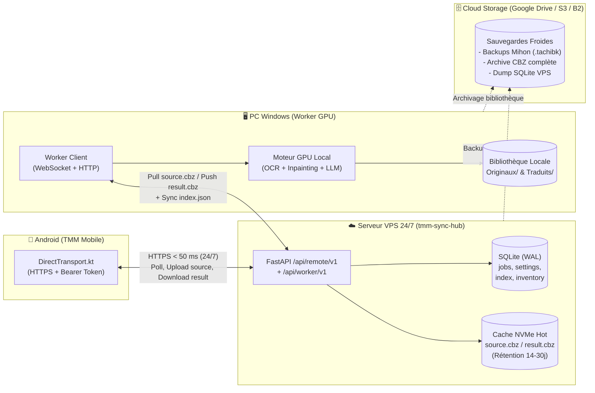

# Étude Architecturale : Serveur VPS de Synchronisation, Worker PC & Sauvegardes Cloud

Date : 2026-10-25  
Périmètre : `translate-my-manga-win` (PC Windows) & `app-translate-my-manga` (Android Mobile)  
Auteur : Architecture & Pair Programming Senior

> Rapport miroir synchronisé avec `translate-my-manga-win/doc/reports/etude_architecture_vps_sync.md`.

---

## 1. Synthèse Exécutive & Remise en Question Critique

Ta proposition contient **deux idées distinctes** qu'il faut séparer strictement sur le plan architectural :

| Proposition | Verdict | Justification factuelle |
| :--- | :--- | :--- |
| **A. « Tout transférer sur le VPS »** *(y compris le moteur de traduction OCR / Inpainting)* | ❌ **Fausse bonne idée** *(Disqualifiée)* | Le pipeline `manga-image-translator` (`ctd`, `mocr`, `lama_large`) exige **2,5 à 4 Go de VRAM CUDA** et **≥ 8 Go de RAM libre** (`core-engine/hardware/hardware_profile.py:17-19`). Sur un VPS CPU abordable (5–10 €/mois), l'inpainting `lama_large` prend **5 à 15 min/chapitre** avec un risque constant d'OOM Killer. Sur un VPS GPU dédié 24/7, la facture grimpe à **150–400 €/mois** pour une machine inactive 95 % du temps, alors que le GPU de ton PC est déjà amorti. |
| **B. « VPS en Hub de Synchronisation 24/7 + PC en Worker GPU + Cloud pour les sauvegardes »** | ✅ **Excellente idée** *(Recommandée)* | Élimine 100 % de la latence Google Drive sur le chemin critique, supprime le blocage de connexion quand le PC est éteint, permet l'envoi de chapitres, la récupération des traductions terminées et la synchro de la bibliothèque **24h/24 en < 50 ms**, tout en réutilisant **90 % du protocole `remote/v1` déjà codé**. |

---

## 2. Diagnostic : Pourquoi l'architecture actuelle souffre de latence quand le PC est éteint

L'inspection du code source des deux dépôts révèle **trois goulots d'étranglement cumulés** :

### 2.1. Le double délai de bascule (`TransportRouter` + `DirectTransport`)
Dans `app/src/main/java/com/tmm/mobile/transport/TransportRouter.kt:16-17` et `DirectTransport.kt:70-79` :
- Avant chaque opération, le téléphone teste `direct.health()` avec un timeout de **6 secondes** (`healthTimeoutSeconds = 6`).
- Lorsque le PC est éteint ou en veille, son nœud Tailscale ne répond pas aux paquets SYN : l'application mobile **attend jusqu'à 6 secondes dans le vide** avant même de commencer à interroger Google Drive.

### 2.2. Google Drive détourné en base de données temps réel
Dans `DriveTransport.kt` et `core-engine/drive/bridge.py` :
- Google Drive API v3 est un stockage de documents, pas un broker de messages.
- Chaque écriture JSON (`writeFixedJson`, `DriveTransport.kt:119-129`) exécute un `files.list` (`findChild`) suivi d'un `PATCH`/`POST` multipart (2 allers-retours TLS de 300 à 600 ms chacun).
- **Envoyer 1 chapitre sur Drive** = `ensureJobFolder` + `startResumable` + `putChunk` + `findChild` + `createJson(request.json)` = **5 à 7 requêtes HTTP séquentielles** (3 à 8 s hors transfert binaire).
- **Rafraîchir l'écran d'accueil (`pollDrive`)** = `pollPc` (liste + lecture de 4 JSON) puis `poll` complet (liste paginée + jusqu'à 6 téléchargements parallèles de `status.json`/`result.json` via `POLL_PARALLEL_READS = 6`). Temps total mesuré : **3 à 10 secondes**.
- **Mis bout à bout (PC éteint)** : `6 s (timeout Direct)` + `4 à 8 s (poll Drive)` = **10 à 14 secondes d'attente** à l'ouverture de l'app.

### 2.3. Fragilité structurelle du pont Drive (Audits du 13/10/2026)
Les rapports `docs/AUDIT_DRIVE_MOBILE_WINDOWS_2026-10-13.md` et `docs/AUDIT_INTERACTION_PC_MOBILE.md` montrent que la majorité des bugs complexes du projet proviennent de l'utilisation de Drive comme boîte aux lettres :
- **P1** : Création concurrente de deux dossiers `TranslateMyManga` / `jobs` / `pc` (split-brain entre mobile et PC).
- **P1/P2** : Boucles infinies et reprises fragiles sur les sessions d'upload resumable Drive (`308 Resume Incomplete` / `403 storageQuotaExceeded`).
- **M6 / P2** : Dossiers de jobs annulés/échoués jamais purgés qui saturent le quota Google Drive de 15 Go.
- **M9** : `resendStalledDriveJobs` qui détruit et recrée les jobs au bout de 10 min sans savoir si le PC est simplement éteint.
- **M11** : Obligation de demander la portée sensible `https://www.googleapis.com/auth/drive` (accès complet à tout le Drive de l'utilisateur).

---

## 3. Comparatif des Architectures Possibles

| Critère | **Actuel (Tailscale PC + Drive)** | **Option 1 : VPS Sync Hub + PC Worker + Cloud Backup** *(Recommandé)* | **Option 2 : VPS Sync Hub + Traduction CPU de secours sur VPS** | **Option 3 : 100 % sur VPS GPU** |
| :--- | :--- | :--- | :--- | :--- |
| **Latence poll mobile (PC allumé)** | ~50–100 ms (via Tailscale) | **~30–60 ms** (HTTPS direct VPS) | **~30–60 ms** | ~30–60 ms |
| **Latence poll mobile (PC éteint)** | **10 à 14 s** (timeout 6s + Drive) | **~30–60 ms** (VPS toujours actif) | **~30–60 ms** | ~30–60 ms |
| **Connexion sans VPN actif sur Android** | Non (Tailscale requis pour le direct) | **Oui** (HTTPS public sur VPS avec Bearer Token) ou via Tailscale | **Oui** | Oui |
| **Envoi de chapitres & récup. des `result.cbz` (PC éteint)** | Lent et fragile (Drive API) | **Instantané** (stockés sur le NVMe du VPS) | **Instantané** | Instantané |
| **Consultation catalogue / réglages (PC éteint)** | Lente (lecture de fichiers Drive) | **Instantanée** (SQLite sur VPS) | **Instantanée** | Instantanée |
| **Exécution de la traduction (PC éteint)** | En attente du réveil du PC | En file sur le VPS (ou réveil PC par Wake-on-LAN) | **Oui en mode lent CPU** (3–8 min/chap) si PC éteint, **GPU rapide** dès que PC allumé | Oui en temps réel |
| **Rôle de Google Drive / Cloud** | Boîte aux lettres temps réel (inadapté) | **Vrai rôle de sauvegarde à froid** (backups `.tachibk`, archives CBZ longue durée) | **Sauvegarde à froid** | Sauvegarde à froid |
| **Coût d'infrastructure** | 0 €/mois | **3,50 à 6 €/mois** (1 vCPU, 2 Go RAM, 40 Go NVMe — ou VPS existant) | **8 à 14 €/mois** (4 vCPU ARM/x86, 8 Go RAM) | **150 à 400 €/mois** (GPU dédié) |
| **Effort de développement** | Corrections P1/P2 Drive complexes | **Faible à Moyen** (réutilise `remote/app.py` et `DirectTransport.kt`) | Moyen (portage Docker CPU de MIT) | Moyen mais ruineux |

---

## 4. Architecture Cible Recommandée : Le VPS « Sync Hub » (Option 1)

### 4.1. Principe directeur (Zéro réinvention, 90 % de réutilisation)

L'application mobile (`DirectTransport.kt`) et le serveur PC (`core-engine/remote/app.py`) implémentent **déjà** le protocole HTTP `/api/remote/v1/` :
- `GET /health`, `POST /pair`, `GET /poll`
- `PUT /jobs/{jobId}/source`, `POST /jobs/{jobId}`, `GET /jobs/{jobId}/result.cbz`
- `POST /jobs/{jobId}/cancel`, `POST /jobs/{jobId}/received`
- `POST /commands`, `PUT /inventory`

**L'idée clé** : Au lieu que `/api/remote/v1/` tourne uniquement sur le PC Windows (qui s'éteint), **ce service léger tourne 24h/24 sur le VPS** (`tmm-sync-hub`).
- Pour le téléphone, **le VPS est l'unique interlocuteur temps réel** : il répond en 40 ms 24h/24.
- Le PC Windows devient un **Worker de calcul GPU** qui se connecte au VPS quand il est allumé pour dépiler les jobs lourds.

### 4.2. Cycle de vie détaillé (Même quand le PC est éteint)

1. **Ouverture de l'application mobile (PC éteint ou allumé)** :
   - Le téléphone appelle `GET https://vps.../api/remote/v1/poll?since=<cursor>`.
   - Le VPS lit sa base SQLite locale et répond en **~40 ms** avec :
     - `statuses` et `results` de tous les jobs,
     - le dernier `index` connu de la bibliothèque PC,
     - les `settings` à jour (avec versionning transactionnel SQLite, éliminant le bug P2 de concurrence `SettingsSync`),
     - l'état du worker PC (`workerOnline: true/false`, `lastSeenAt`, `activeJobIds`).
2. **Téléchargement d'un chapitre déjà traduit (PC éteint)** :
   - Le PC a traduit 15 chapitres pendant la nuit, les a poussés sur le VPS (`result.cbz`), puis s'est mis en veille ou a été éteint.
   - Le matin dans les transports, tu ouvres ton téléphone : les 15 chapitres sont immédiatement disponibles sur le VPS (`GET /jobs/{id}/result.cbz`) à la vitesse maximale de la 4G/5G/fibre du VPS, **sans allumer le PC et sans passer par Google Drive**.
3. **Envoi de nouveaux chapitres à traduire (PC éteint)** :
   - Le téléphone envoie `PUT /jobs/{id}/source` + `POST /jobs/{id}` au VPS.
   - Le VPS vérifie immédiatement la taille et le `SHA-256`, stocke `source.cbz` dans sa file NVMe, et renvoie `status = queued` en quelques millisecondes.
4. **Exécution dès que le PC est disponible (ou via Wake-on-LAN)** :
   - Dès que le PC Windows est allumé (ou réveillé à distance via un paquet Wake-on-LAN relayé sur Tailscale), son `Worker` reçoit une notification instantanée via WebSocket (`/api/worker/v1/stream`).
   - Il télécharge `source.cbz` depuis le VPS, exécute la traduction sur sa carte NVIDIA, archive l'original et le traduit sur le disque du PC, et pousse `result.cbz` + le nouvel `index.json` vers le VPS.
   - Dès que le téléphone envoie `POST /jobs/{id}/received` au VPS, le VPS supprime les fichiers temporaires `source.cbz` et `result.cbz` de son cache NVMe.

### 4.3. Gestion des sauvegardes sur le Cloud (Tiering Hot / Cold)

Pour garder un VPS très économique (20 à 40 Go de disque NVMe), il ne faut pas y stocker l'intégralité historique des mangas, mais appliquer une séparation **Hot / Cold** :

| Couche | Emplacement | Contenu | Rétention & Rôle |
| :--- | :--- | :--- | :--- |
| **Hot (Temps réel)** | **VPS (SQLite + NVMe)** | Métadonnées (`index.json`, `settings.json`, `phone_inventory.json`, état des `jobs`), `source.cbz` en file d'attente, `result.cbz` en attente de récupération par le téléphone, et dernière sauvegarde Mihon `.tachibk`. | `source.cbz` supprimé dès réception par le PC ; `result.cbz` supprimé dès `received` par le mobile (ou TTL 14 jours). Empreinte disque : **< 5 Go**. |
| **Warm (Travail)** | **PC Windows (Disque local)** | Bibliothèque complète (`Originaux/`, `Traduits/`), modèles IA (`manga-image-translator`, `Ollama`), cache de vérification. | Stockage principal de production. |
| **Cold (Sauvegarde)** | **Cloud (Google Drive / S3 / Backblaze B2)** | 1. Sauvegardes Mihon `.tachibk` 2. Miroir chiffré/compressé de la bibliothèque `Traduits/` (`rclone sync` nocturne) 3. Backup quotidien de la base SQLite du VPS | Archivage et reprise après sinistre (crash disque PC ou VPS), **100 % hors du chemin critique de l'application mobile**. |

> [!TIP]
> **Option bonus : Récupération d'un ancien chapitre traduit quand le PC est éteint (`redeliver`)**  
> Si le dossier `Traduits/` du Cloud est monté ou accessible en lecture par le VPS (via `rclone` ou l'API Drive côté serveur), le VPS peut même servir directement un ancien chapitre déjà traduit (`mode: redeliver`) **sans avoir besoin que le PC est allumé** !

---

## 5. Et si on veut quand même traduire quand le PC est éteint ? (Option 2 : Hybride GPU PC + Fallback CPU VPS)

Si ton besoin inclut parfois de traduire **1 ou 2 chapitres urgents en déplacement alors que le PC est éteint**, sans payer un VPS GPU :

1. **Pourquoi ça peut marcher en secours uniquement** :
   - Lorsque le fournisseur de traduction est un LLM Cloud (**Gemini, OpenAI, Claude, DeepL**), l'étape de traduction linguistique ne consomme aucune ressource locale.
   - Seules la détection (`ctd`), l'OCR (`mocr`) et l'inpainting (`lama_large` ou `lama_mpe`) tournent sur la machine.
   - Sur un VPS doté de **4 vCPU et 8 Go de RAM** (ex: Hetzner CAX21 ARM64 ou CPX31 x86 à ~7–10 €/mois), `manga-image-translator` en mode `--use-gpu=false` et `--inpainter=lama_mpe` (plus léger que `lama_large`) traite un chapitre de 20 pages en **~3 à 6 minutes** (contre ~30 s sur ton PC GPU).
2. **Orchestration intelligente (Priorité PC GPU > Fallback VPS CPU)** :
   - Si le PC Windows est en ligne (`workerOnline == true`), **100 % des jobs sont pris par le PC**.
   - Si le PC est hors ligne depuis plus de $N$ minutes (ou si l'utilisateur coche « Traduire sur le VPS si PC éteint »), un worker CPU sur le VPS traite le chapitre en arrière-plan.
   - **Mon avis d'architecte** : **Ne commence pas par l'Option 2.** Déploie d'abord l'Option 1 (VPS Sync Hub pur, ultra-léger, < 200 Mo de RAM). Tu auras déjà 100 % du gain de latence, l'accès aux chapitres déjà traduits et la mise en file hors-ligne. Si à l'usage le besoin de traduire PC éteint se confirme, il suffira de lancer le même client Worker en Docker CPU sur le VPS (sans toucher à l'architecture).

---

## 6. Exposition Réseau & Sécurité du VPS

Avec un VPS, deux modes d'exposition sont possibles pour le téléphone :

| Mode d'accès au VPS | Avantages | Inconvénients |
| :--- | :--- | :--- |
| **1. HTTPS Public sur domaine dédié** (`https://tmm.ton-domaine.fr` derrière Caddy/Nginx) | **Aucun VPN requis sur le téléphone.** Connexion instantanée en 4G/5G/Wi-Fi dès l'ouverture de l'app, zéro consommation batterie de VPN, compatible même si un autre VPN est actif sur Android. | Surface publique : exige un durcissement strict (Bearer Token 256 bits, rate-limiting sur `/pair`, taille max du body, TLS 1.3). |
| **2. Tailscale sur le VPS** (`https://vps.<tailnet>.ts.net`) | Zéro port ouvert sur Internet public. Authentification réseau WireGuard + `Tailscale-User-Login`. | Oblige à laisser l'application Tailscale active sur Android. |

**Recommandation Sécurité** :
Le protocole actuel (`DirectTransport.kt` + `remote/auth.py`) utilise déjà un jeton aléatoire de 256 bits (`secrets.token_urlsafe(32)`), stocké dans l'**Android Keystore AES-GCM** côté mobile et haché en **SHA-256 + comparaison en temps constant (`hmac.compare_digest`)** côté serveur.  
En ajoutant un reverse-proxy **Caddy** (TLS automatique Let's Encrypt) avec limitation de débit sur `/pair` et `/health`, et un jeton `WORKER_SECRET` distinct pour le PC Windows, **l'exposition HTTPS directe est sûre et offre la meilleure expérience mobile possible (0 configuration VPN)**.

---

## 7. Impact sur le Code Existant & Simplification

Passer par un VPS Sync Hub permet de **simplifier drastiquement** la base de code :

1. **Côté Mobile (`app-translate-my-manga`)** :
   - `DirectTransport.kt` devient le **transport principal unique** pointant vers le VPS.
   - Plus d'attente de 6 secondes sur `health()` suivie d'un repli lent.
   - Possibilité d'ajouter un endpoint **Upload Resumable par chunks** (ou `Range`) sur le VPS si nécessaire pour les connexions 4G très instables, bien plus simple et déterministe que l'API Drive.
   - `DriveTransport.kt` peut être conservé uniquement en option d'import/export de sauvegarde `.tachibk` ou décommissionné pour le suivi des jobs, éliminant les bugs **P1, P2, M6, M7, M9, M11**.
2. **Côté Serveur VPS (`tmm-sync-hub`, nouveau micro-service Python/FastAPI)** :
   - Reprend directement `core-engine/remote/app.py` (~300 lignes) + `remote/auth.py` + un store SQLite (`hub_store.py`) remplaçant `drive_bridge.json`.
   - Ajoute 4 routes Worker réservées au PC Windows (`/api/worker/v1/poll`, `/api/worker/v1/jobs/{id}/source`, `/api/worker/v1/jobs/{id}/result`, `/api/worker/v1/state`).
3. **Côté PC (`translate-my-manga-win`)** :
   - Remplace la boucle complexe de `drive/bridge.py` (1868 lignes de gestion des caprices de Google Drive API v3 !) par un client HTTP/WebSocket léger (`vps_worker.py`, ~250 lignes) qui tire les jobs du VPS et pousse les résultats.

---

## 8. Découpage Fonctionnel Prévisionnel (PBS / WBS)

Si tu valides cette orientation (Option 1), voici le découpage en lots incrémentaux et indépendants :

- **WBS 1 — Spécification du contrat Worker & Service `tmm-sync-hub` (VPS)**
  - **1.1** : Schéma SQLite transactionnel du Hub (`jobs`, `settings`, `pc_index`, `phone_inventory`, `devices`).
  - **1.2** : Migration des routes `/api/remote/v1/*` (contrat mobile inchangé) sur le store SQLite du Hub.
  - **1.3** : Création des routes `/api/worker/v1/*` (authentification PC Worker, récupération de `source.cbz`, publication de `status`/`result.cbz`/`index.json`, heartbeat Worker).
  - **1.4** : Purge automatique (TTL) du cache NVMe (`remote_inbox` / `remote_outbox`) après accusé `received`.
- **WBS 2 — Connecteur Worker côté PC (`translate-my-manga-win`)**
  - **2.1** : Client asynchrone `core-engine/vps/worker_client.py` (WebSocket/Long-polling vers le VPS + téléchargement/upload de CBZ avec vérification SHA-256).
  - **2.2** : Synchronisation bidirectionnelle atomique des réglages (`settings`) et publication du catalogue (`index.json`) vers le VPS.
  - **2.3** : Interface Réglages PC (URL du VPS, clé Worker, état de connexion temps réel).
- **WBS 3 — Adaptation Mobile (`app-translate-my-manga`)**
  - **3.1** : Connexion permanente de `DirectTransport` sur le VPS (distinction claire entre `vpsReachable` et `pcWorkerOnline` dans `Heartbeat`).
  - **3.2** : Affichage dans l'UI mobile de l'état dissocié : *« Synchronisé avec le serveur • PC éteint (X chapitres en file pour le prochain démarrage) »*.
- **WBS 4 — Sauvegardes Cloud à froid & Déploiement Docker VPS**
  - **4.1** : `Dockerfile` + `docker-compose.yml` + `Caddyfile` (HTTPS auto) pour le VPS.
  - **4.2** : Script de backup automatisé (base SQLite + sauvegardes Mihon vers le Cloud).
